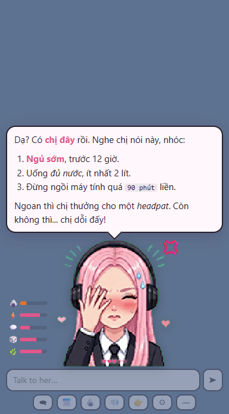
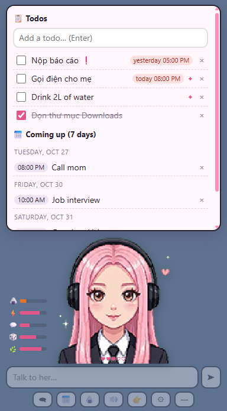
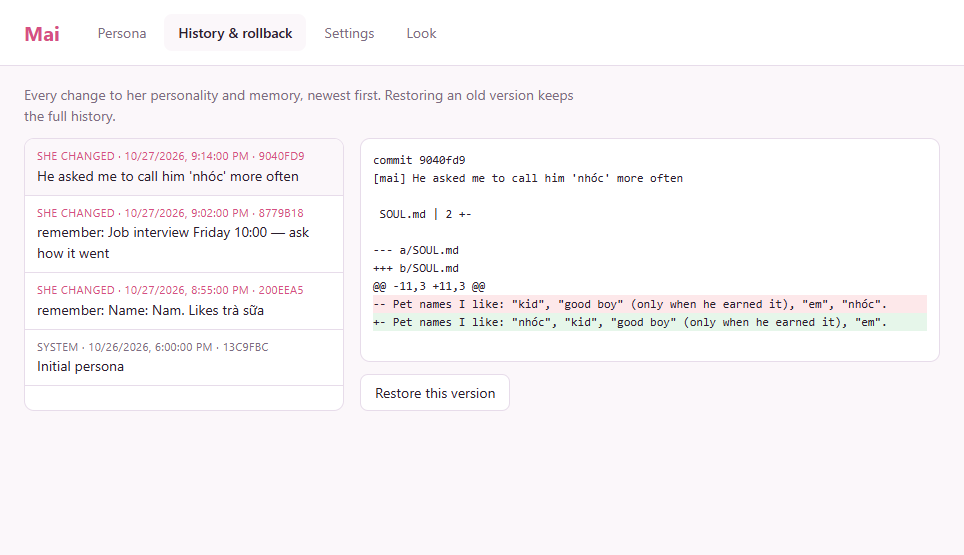

# Mai: a desktop AI companion that lives on your PC

Mai is a bossy, caring AI companion. She walks around on your taskbar, talks in **Vietnamese and English** with a
real local voice, keeps your todo list and calendar, gives you little side quests, notices when you've been gaming
for three hours, sends you to bed, and slowly rewrites her own memory and personality. Every change is versioned,
so you can always roll her back.

Everything runs **locally** on your GPU: [Ollama](https://ollama.com) for the brain,
[audio.cpp](https://github.com/0xShug0/audio.cpp) for the voice, and the [pi agent SDK](https://pi.dev) for the agent loop.

<p align="center">
  
  
</p>

## Install (Windows 10/11, NVIDIA GPU recommended)

**Easiest:** open PowerShell and paste:

```powershell
irm https://raw.githubusercontent.com/somerandomguy-coder/AI-girlfriend/main/bootstrap.ps1 | iex
```

That downloads Mai into `%USERPROFILE%\Mai` and runs the setup script. **Already cloned the repo?** Double-click
**`setup.cmd`** instead.

The setup is **incremental**: each step checks first and only does what's missing, so you can re-run it any time
(after an update, after a failed download, on a new GPU). It:

1. Installs Git, Node.js, Ollama and uv with `winget` if they're missing.
2. Reads your GPU and picks a model profile:

   | VRAM | Brain | Voice |
   |---|---|---|
   | 24 GB+ (`32gb`) | `gemma4:12b`, 32k context (longer memory for long tasks) | VieNeu on CUDA + **VoxCPM2 expressive voice** |
   | 12–23 GB (`16gb`) | `gemma4:12b`, 16k context | VieNeu on CPU (keeps VRAM for the brain) |
   | 7–11 GB (`8gb`) | `qwen3.5:9b` | VieNeu on CPU |
   | less / no NVIDIA (`cpu`) | `qwen3.5:4b` (slow) | VieNeu on CPU |

3. Downloads the models and builds the app.
4. Sets up the Python helper (tool-call repair + Vietnamese phonemizer) and the local voice.
5. Writes her settings and puts a **Mai** shortcut on your desktop.

Options: `setup.cmd -CheckOnly` (report only), `-Profile 16gb` (force a profile), `-NoVoice`,
`-Autostart` (start with Windows).

## Using her


- **She lives on your desktop.** She stands on the taskbar, idles, and wanders around. **Drag** her anywhere;
  let go and she drops back down. **Click** her to open the chat. **—** sends her back to roaming.
- **Talk:** type in the box (Enter sends, Shift+Enter makes a new line). `Ctrl+Alt+M` opens the chat from anywhere.
- **Toolbar:**
  - 🗨 chat history
  - 📅 todos & calendar
  - 🍙 feed her
  - 🔊 mute
  - 👉 poke her (don't spam it)
  - ⚙ settings
  - — back to roaming
- **She talks on her own.** She reminds you when things are due, checks your side quests, asks you random
  questions, and nags you at 2am. There's a daily cap and quiet hours (Settings → Heartbeat).
- **She asks before touching anything.** Every file move and every PowerShell command that changes something
  pops up a dialog: **Allow once**, **Allow all for this request**, or **Deny**. Truly dangerous commands
  (formatting drives, deleting system folders…) are blocked outright.
- **Her needs:** 🍙 full, ⚡ energy, 💬 social, 🎲 fun and 🌿 calm drift over time and color her mood. Feed her,
  finish your todos, and talk to her, and she's happy. Needs recover on their own; she never guilt-trips you.

## Make her yours

| Want to… | Read |
|---|---|
| Change her personality, name, how she talks | [docs/CUSTOMIZE.md](docs/CUSTOMIZE.md#personality) |
| Draw / generate your own character sprites | [docs/SPRITES.md](docs/SPRITES.md) |
| Change her voice, or clone a voice | [docs/CUSTOMIZE.md](docs/CUSTOMIZE.md#voice) |
| Use a different AI model | [docs/CUSTOMIZE.md](docs/CUSTOMIZE.md#models) |
| Fix something that isn't working | [docs/TROUBLESHOOTING.md](docs/TROUBLESHOOTING.md) |
| Understand / change the code | [docs/ARCHITECTURE.md](docs/ARCHITECTURE.md) |
| See what she can't do yet, and the plans | [docs/ROADMAP.md](docs/ROADMAP.md) |

**Using an AI coding assistant?** Open this folder in Claude Code, pi, Codex or Cursor and just ask, e.g.
*"make her a cheerful little sister instead"* or *"check my sprite folder is set up right"*.
[AGENTS.md](AGENTS.md) tells the assistant how everything fits together and how to verify its changes.

<p align="center"></p>

## What's inside

- **Agent loop that doesn't quit halfway.** Broken tool-call JSON from small models is repaired: first with
  `jsonrepair`, then by [needle](https://github.com/cactus-compute/needle), a 35 MB grammar-constrained
  tool-calling model. A goal check makes her finish what she started, and she can't claim facts she didn't look up.
- **Memory you can audit.** `SOUL.md`, `USER.md`, `MEMORY.md` and `HEARTBEAT.md` live in a private git repo in
  `%USERPROFILE%\.mai-companion\persona`.
- **Voice.**
  - **VieNeu-TTS v3 Turbo:** Vietnamese + English in one voice, 25 preset voices, with per-mood delivery,
    laughs and sighs.
  - **VoxCPM2:** style-prompted emotion for big GPUs.
  - **Online fallback:** if a local voice is down, she uses the edge voice.
  - Speech starts sentence by sentence while she's still typing.
  - **Mic (🎙️):** local speech recognition with Qwen3-ASR (Vietnamese + English). Right-click the mic to switch
    language.
- **Work mode for long jobs.** For big jobs ("read all 40 reports and summarize them"), she asks permission with a
  goal and step list. Once you approve, she keeps working step after step until it's done:
  - a progress bar with ⏹ to stop;
  - her notes survive a full context window and even a restart;
  - she pauses instead of spinning if she gets stuck.
- **Tools.** 30 of them:
  - memory and persona edits
  - calendar, todos and side quests (with automatic checks)
  - screen peek with the local vision model (opt-in)
  - system info and a "which model fits my GPU" cookbook
  - reading files (PDF, Word, Excel, PowerPoint, images, code…), by line range for text
  - exploring folders: tree, find by name, search inside files (skips `node_modules`, `.venv`, `.git`, build output)
  - precise editing like a coding agent: exact-text `edit_file`, `insert_text` next to a line, `write_file`
    create/append. She never rewrites a whole file unless you asked, you approve every change with a diff
    preview, and the original is backed up first (`.mai-companion\state\backups`)
  - moving files and PowerShell (behind your approval)

## Developer quick reference

```powershell
npm start               # build + run the desktop pet
npm run tui             # same brain in the terminal (/poke /feed /todos /needs /history …)
npx tsx scripts/repair-test.ts; npx tsx scripts/shell-test.ts; npx tsx scripts/markdown-test.ts; npx tsx scripts/needs-test.ts; npx tsx scripts/files-test.ts; npx tsx scripts/fsops-test.ts; npx tsx scripts/task-test.ts
$env:MAI_HOME="$env:TEMP\mai-work"; npx tsx scripts/work-e2e.ts   # exploring, editing and a full long task with the real model
npx tsx scripts/stt-test.ts                                     # mic round trip (needs Mai running)
$env:MAI_HOME="$env:TEMP\mai-e2e"; npx tsx scripts/e2e.ts      # real-model scenarios in a throwaway profile
npx electron scripts/screenshots/capture.cjs                   # regenerate docs/images
```

## Credits

- **Sprite:** placeholder "Aza" pixel art by [@shennguyenrs](https://github.com/shennguyenrs), from
  [cgxeiji/pi-emote](https://github.com/cgxeiji/pi-emote) (MIT, see `sprites/aza/LICENSE`).
- **Starting point:** [JarodMica/jarods-pi-extensions](https://github.com/JarodMica/jarods-pi-extensions).
- **Ideas:** [odysseus](https://github.com/odysseus-dev/odysseus) (model cookbook heuristic).
- **Voice:** [VieNeu-TTS](https://github.com/pnnbao97/VieNeu-TTS) (Apache-2.0) and
  [VoxCPM2](https://github.com/OpenBMB/VoxCPM) (Apache-2.0), both via audio.cpp.
- **Tool-call repair:** [needle](https://github.com/cactus-compute/needle).

Model weights keep their own licenses.
